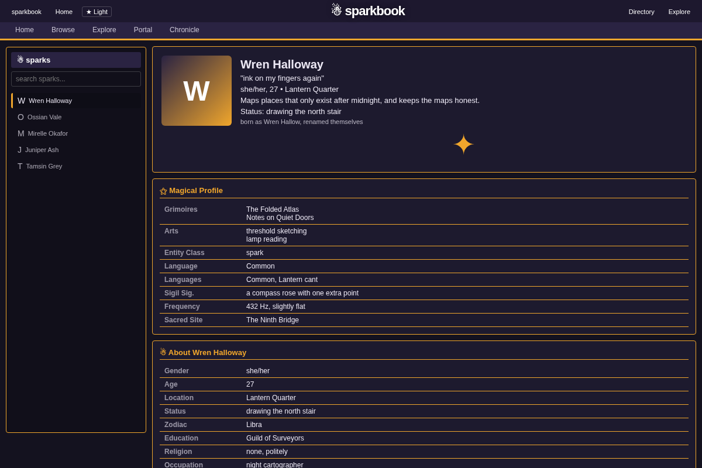
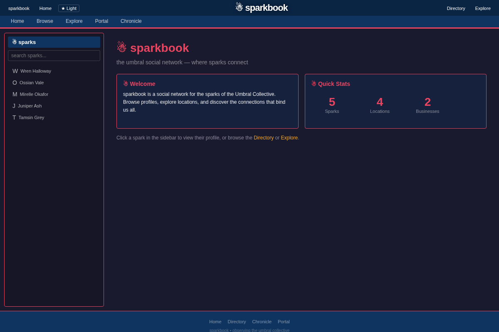
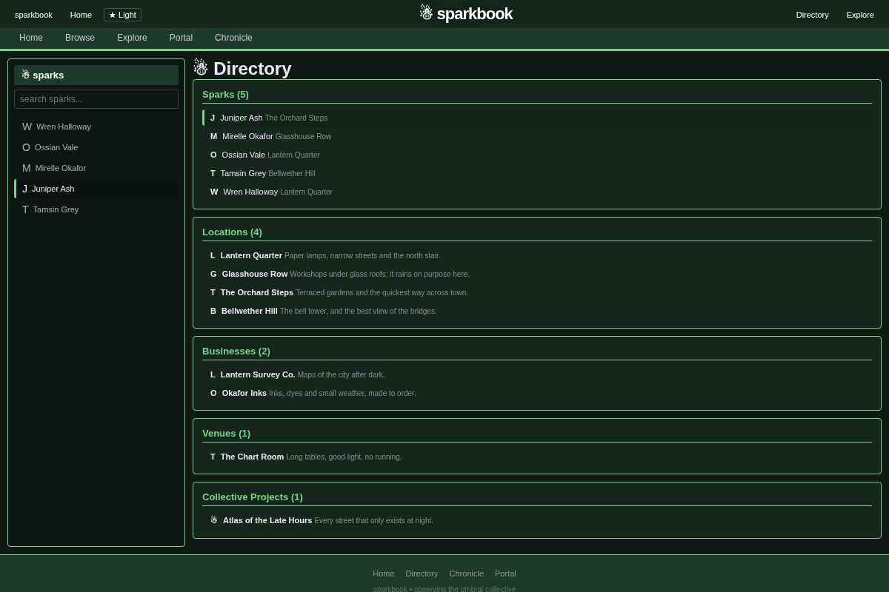
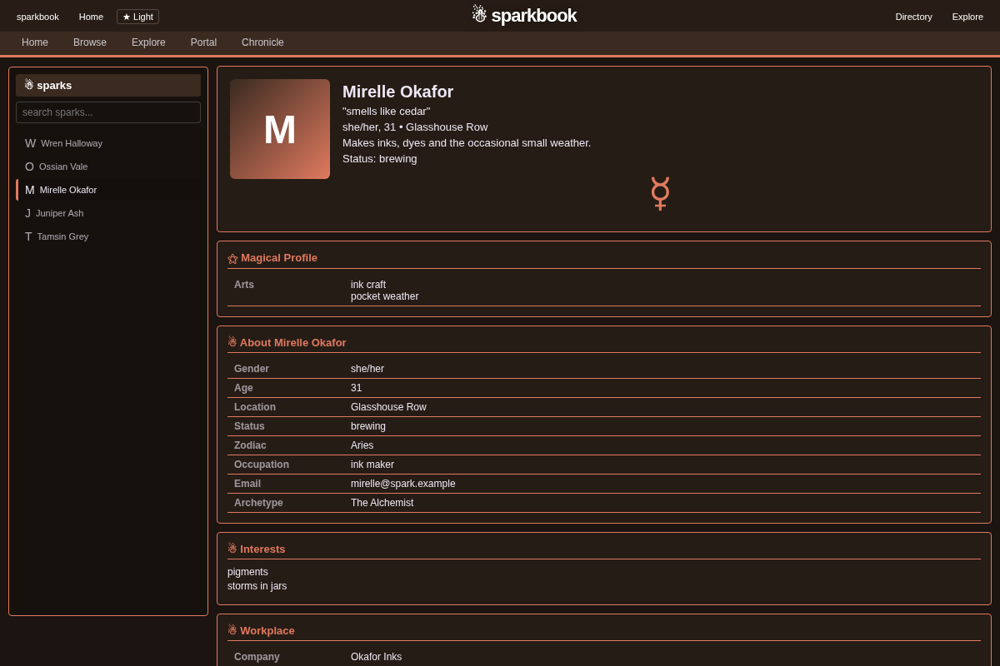

# sparkbook

*The umbral social network.*

sparkbook is an old-school, MySpace-style profile site for **sparks**: the
characters who live in the Umbral Collective, the world of the
[Umbreality](https://umb.alola.lol) project. Every spark has a profile page with
its own colors, a mood, friends, a workplace, plans, journal entries and the
odd personality quiz. You browse them the way you browsed profiles in 2006.

<p align="center"></p>

## Why

The sparks are generated and keep changing: new journals, new bonds, new
jobs. A wiki would go stale and a database dump is unreadable. A social
network is a shape everyone already knows how to read, so it's the easiest way
to see who someone is and who they know.

## Features

- **Profiles**: banner, mood, magical profile, about, interests, workplace and
  coworkers, plans, bonds, recent journal entries, home location, quizzes
- **Per-profile themes**: each spark brings its own colors and font, and
  **★ Light / ☰ Dark** swaps to its alternate palette
- **Directory**: every spark A-Z, plus locations, businesses, venues and
  collective projects
- **Explore**: six random sparks and a few random connections, reshuffled on demand
- **Sidebar search** that filters as you type
- **Real URLs**: `#/spark/<name>`, `#/directory` and `#/explore` can be
  bookmarked and shared
- Plain HTML, CSS and JavaScript, with no build step, no framework and no
  dependencies

<p align="center">
  
  
</p>
<p align="center"></p>

## Run it

Try it with the made-up demo sparks in `demo/data.json`. You need Python 3,
and nothing else:

```sh
git clone https://github.com/nviiiivn/sparkbook.git
cd sparkbook
python3 demo/serve.py        # http://127.0.0.1:8911/
```

To use real data, serve `index.html`, `script.js` and `style.css` from the
root of any web server and answer the three routes below under `/book` on the
same origin. To use a different prefix, change `API` at the top of `script.js`.

## API

The page only reads, and only with `GET`:

| Route | Returns |
| --- | --- |
| `/book/sparks` | `{"sparks": [{"name": "...", "location": "..."}]}` |
| `/book/directory` | `{"locations": [...], "businesses": [...], "venues": [...], "projects": [...]}`, each item `{"name", "description"}` |
| `/book/spark/<name>` | one profile (below) |

A profile is one JSON object. Every field is optional, and sections with no
data are left out:

```json
{
  "identity": {"title": "", "gender": "", "age": 0, "location": "", "status": "", "sigil": "✦",
               "archetype": "", "archetype_desc": "", "birth_name": "", "zodiac": "", "occupation": "",
               "grimoires_studied": [], "magical_arts": [], "known_languages": [],
               "themes": {"bg": "#1a1a2e", "bg2": "", "accent": "", "text": "", "link": "",
                          "header_bg": "", "box_bg": "", "border": "", "font": "Georgia, serif"},
               "themes_alt": {}},
  "emotion": {"mood": ""},
  "personality": {"interests": [], "about_me": "", "whom_to_meet": ""},
  "workplace": {"company": "", "role": "", "venue": "", "projects_working_on": [], "coworkers": []},
  "plans": [{"title": "", "desc": ""}],
  "social": {"top_friends": [], "friend_count": 0, "is_known_for": "", "groups": []},
  "location_detail": {"name": "", "description": "", "notable_features": []},
  "quiz": [{"type": "", "questions": [{"q": "", "a": []}], "result": ""}],
  "raw": {"journals": [{"created_at": "", "title": "", "content": ""}]}
}
```

`demo/data.json` has complete examples. Every value is escaped before it is
shown, so a profile can't inject markup into the page.

## Configuration

There is no config file. The links in the header and footer (**Portal**,
**Chronicle**, the **sparkbook** home link) point at the Umbreality sites.
Edit them in `index.html` to point at yours.

## Status

A small, finished front end. It is read-only on purpose: sparks are written by
the backend that generates them, not through this page. The live backend is
part of the Umbreality project and isn't in this repo. `demo/serve.py` stands
in for it.

## License

[PolyForm Noncommercial 1.0.0](LICENSE). Free to use, change and share for any
noncommercial purpose. Nobody gets to sell it.
